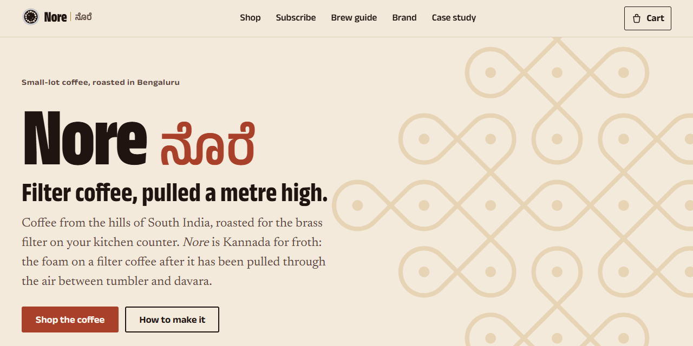
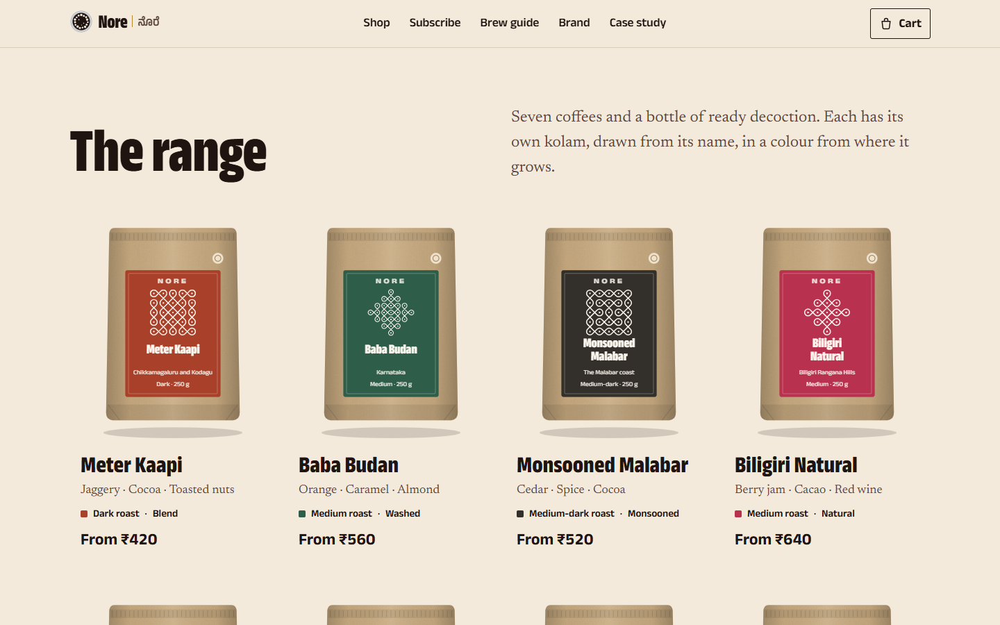
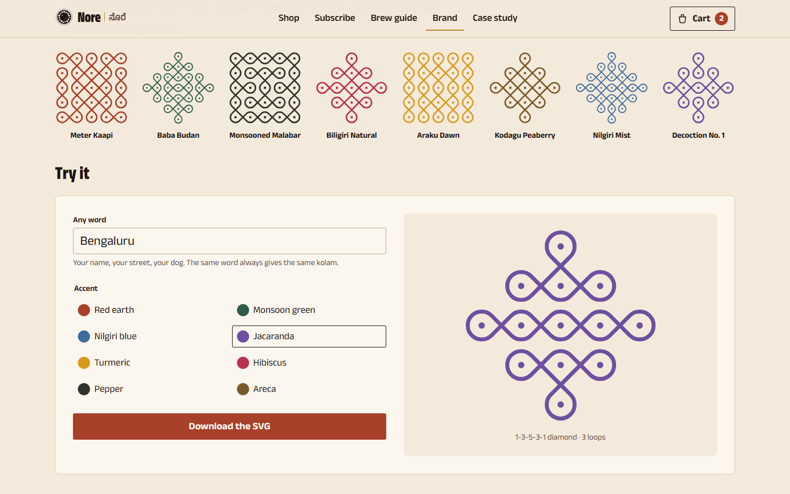
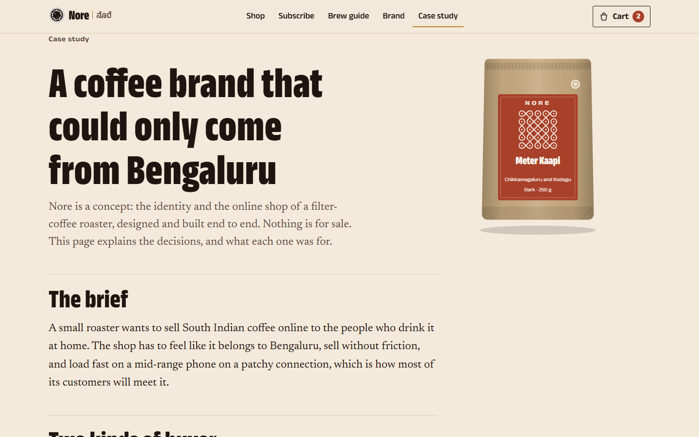
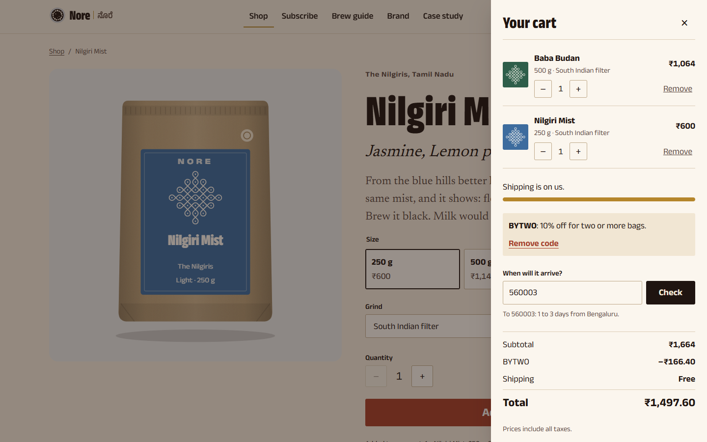
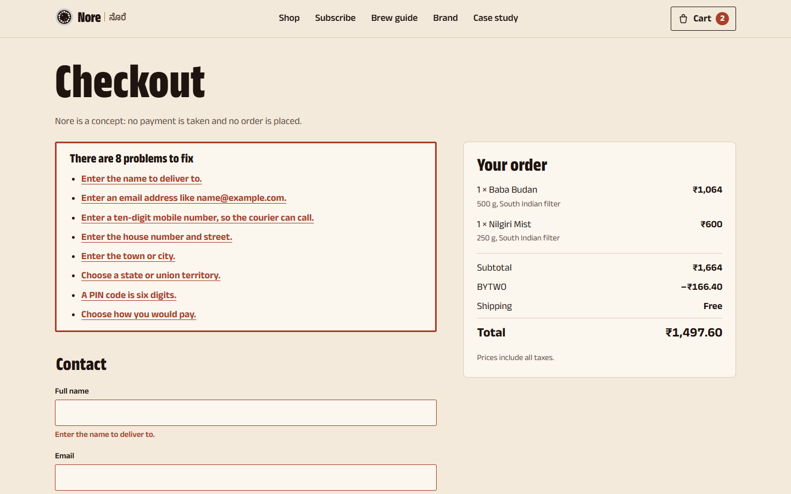
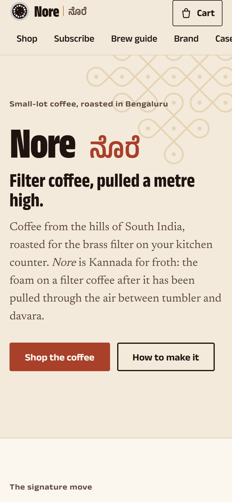
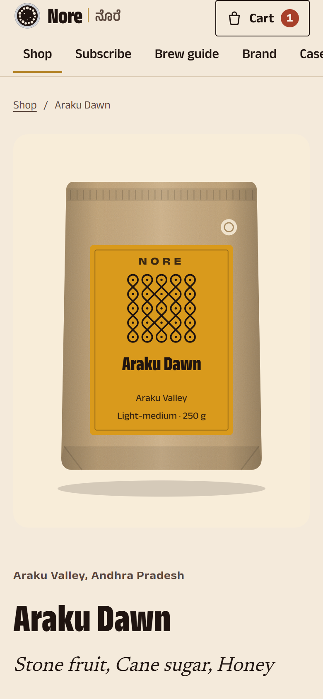
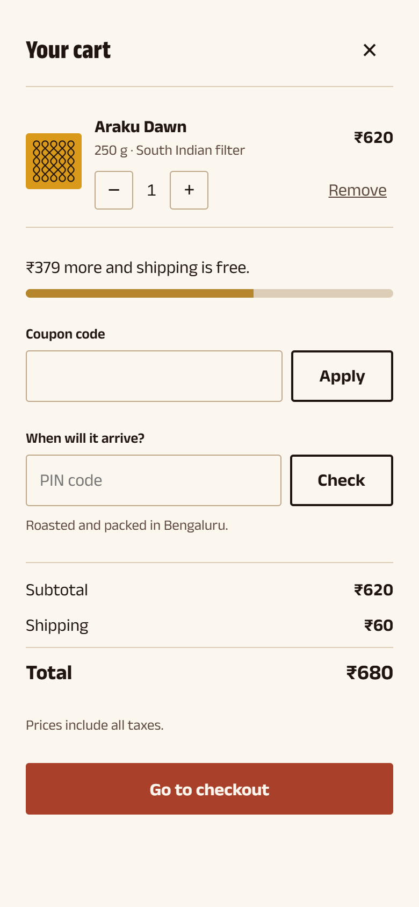
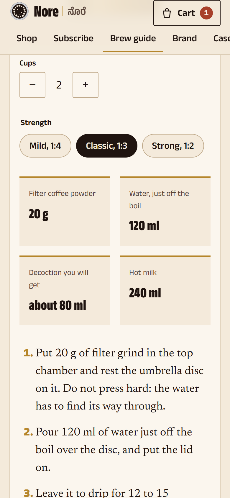

<p align="center"></p>

**Nore is a brand identity and storefront for a Bengaluru filter-coffee roaster, designed and built end to end. It is a concept: nothing is for sale and no order is placed.**

[](https://github.com/Darshanpawar7/nore-coffee/actions/workflows/ci.yml)
[](LICENSE)
[](https://darshanpawar7.github.io/nore-coffee/)



## What it is

_Nore_ (ನೊರೆ) is Kannada for froth: the foam on a South Indian filter coffee after it has been pulled a metre through the air between tumbler and davara. The line is "Filter coffee, pulled a metre high."

This project shows the two halves of the work a small brand needs, done together:

- **An identity.** A name, a mark, a palette taken from the hills the coffee grows on, type, packaging, a voice, and a generative pattern system: every coffee gets its own kolam, drawn from its name.
- **A shop that sells.** A catalogue with real filters, product pages with live prices, a cart, a checkout, a subscription builder and an interactive brew guide. It is fast on a mid-range phone, accessible, and works without JavaScript for reading and browsing.

A [case study](https://darshanpawar7.github.io/nore-coffee/case-study/) on the site explains the decisions, and the [brand guidelines](https://darshanpawar7.github.io/nore-coffee/brand/) document the identity.

## The identity

| The kolam generator                                                                                                     | The case study                                                                 |
| ----------------------------------------------------------------------------------------------------------------------- | ------------------------------------------------------------------------------ |
|  |  |

- **South Indian modernism.** Brass and stainless steel, mosaic floors, a rice-flour kolam at dawn, a screen-printed matchbox label. Not nostalgia kitsch, and not imported minimalism.
- **Colour.** Decoction, froth, milk, brass and earth red, plus one accent per coffee from where it grows: monsoon green for Chikkamagaluru, Nilgiri blue, the pepper of the Malabar coast. The ink on each accent is chosen by contrast in code.
- **Type.** Anek's width axis gives condensed, heavy headlines and normal-width interface text from one family. Anek Kannada is its sibling, and Newsreader carries the stories.
- **The mark.** A steel tumbler seen from above, with a crown of froth bubbles.
- **The kolam system.** A sikku kolam is a line woven around a grid of dots. The coffee's name seeds a generator that picks the grid and opens or closes the gate between each pair of dots, mirrored across both axes. The line is then traced into closed loops: quarter circles where a gate is closed, crossings at 45° where it is open. The same name always gives the same kolam, and every coffee gets its own.
- **Packaging.** One kraft pouch with a degassing valve and a label in the coffee's accent. The colour and the kolam do the talking.
- **Three Kannada words only:** ನೊರೆ, ಕಾಫಿ and ಬೆಂಗಳೂರು. A repository test fails if any other Kannada appears, because a concept should not put words in a language's mouth.

## The shop

| The cart drawer                                                                                                                | The checkout                                                                                      |
| ------------------------------------------------------------------------------------------------------------------------------ | ------------------------------------------------------------------------------------------------- |
|  |  |

<p align="center">
  
  
  
  
</p>

- **The pull.** On the home page, coffee falls a metre from tumbler to davara and the froth rises as you scroll. It uses CSS scroll-driven animation with no script, and shows the finished picture where that is unsupported or motion is reduced.
- **A shop with real filters.** Filter by roast, process and brew method, and sort by price or roast. The choices live in the address, so a filtered view can be shared, and the count is announced to screen readers.
- **Product pages.** The bag tilts towards the pointer and its kolam draws itself. The price follows size and quantity, and the grind defaults to South Indian filter, because that is how most buyers brew. Each page gives a price per cup (at 10 g a cup), a taste chart, origin facts, a recipe and two coffees to try next.
- **The cart.** Adding to the cart never moves the page. The drawer is a modal dialog, with quantity steppers, remove with undo, and progress towards free shipping (free over ₹999, otherwise ₹60). It also takes the BYTWO coupon, 10% off two or more bags, and turns it down with a reason for one. A delivery estimate comes from the PIN code. The cart is kept in local storage, survives reloads and stays in step across tabs.
- **The checkout.** It runs on one page with autofill on every field. Messages say what to do, and an error summary takes focus and links to each field. No card details are ever asked for, and the concept note appears on the form and on the confirmation.
- **Subscriptions.** A three-step builder asks how you brew, then which coffee or the roaster's rotation, then how much and how often. A live summary shows the subscriber price, 10% off every bag.
- **The brew guide.** It works out powder, water, decoction and milk for one to six cups at three strengths. A drip timer keeps real time and finishes without a sound. Ratio cards cover moka pot, pour-over, French press and cold brew.

## Engineering

- **HTML first.** Astro builds static pages. Preact islands hydrate only where there is state, and share it through nanostores.
- **Pure, tested logic.** Money is integer paise. Variant pricing, the cart reducer, coupons, shipping, PIN zones, the brew maths, subscription quotes, checkout validation and the kolam generator are pure TypeScript in `src/lib` with unit tests.
- **Prices are never stored in the cart.** Lines hold identifiers and quantities, and totals look prices up in the catalogue every time. A cart saved last month cannot carry last month's price.
- **The catalogue is a content collection,** validated by a zod schema at build time. The schema lives apart from the types the islands import, so the browser never downloads zod.
- **No photographs.** Every bag, illustration and pattern is SVG drawn in code.
- **A strict Content-Security-Policy** on every page. Astro hashes its own scripts and styles; nothing is inlined as a data URL; no third-party origin is allowed.
- **Cross-document view transitions.** The bag on a card becomes the bag on its page, with no client router. They are off under reduced motion.

### Speed

Lighthouse 12.8 on the production build:

| Page         | Device            | Performance | Accessibility | Best practices | SEO |
| ------------ | ----------------- | ----------- | ------------- | -------------- | --- |
| Home         | Phone (simulated) | 98          | 100           | 100            | 100 |
| Home         | Desktop           | 100         | 100           | 100            | 100 |
| Product page | Phone (simulated) | 97          | 100           | 100            | 100 |
| Product page | Desktop           | 100         | 100           | 100            | 100 |

The first measurement on a phone scored 74. Fonts were 615 KB of a 660 KB page: the rupee sign alone pulled in 81 KB of extended Latin, and three Kannada words pulled in 304 KB. `scripts/subset-fonts.py` now cuts them to 1.8 KB and 9.7 KB. The pages weigh 214 KB, stylesheets are inlined, and the two text fonts are preloaded. `text-wrap: pretty` on every paragraph more than doubled style and layout time on a slowed CPU, so it is gone.

## Getting started

You need Node 24 or later.

```bash
git clone https://github.com/Darshanpawar7/nore-coffee.git
cd nore-coffee
npm ci
npm run dev          # http://localhost:4104/nore-coffee/
```

To serve the production build exactly as GitHub Pages does:

```bash
npm run build && npm run preview     # http://localhost:4204/nore-coffee/
```

On a Windows machine whose policy blocks unsigned native code, Astro's compiler cannot load its native add-on. In that case, run `npm run wasm-fallback` once after `npm ci` to install its WebAssembly build.

## Scripts

| Command               | What it does                                                                 |
| --------------------- | ---------------------------------------------------------------------------- |
| `npm run dev`         | Development server on port 4104                                              |
| `npm run build`       | Static build to `dist/` for the `/nore-coffee/` path                         |
| `npm run preview`     | Serve the build on port 4204                                                 |
| `npm run typecheck`   | Astro check, plus a browser-only program with no Node types                  |
| `npm test`            | Unit tests with coverage                                                     |
| `npm run e2e`         | End-to-end tests in Chrome against the build: desktop, phone, JavaScript off |
| `npm run lint`        | ESLint (strict, type-checked, with accessibility rules) and Prettier         |
| `npm run fonts`       | Rebuild the subset fonts (needs Python with fontTools and brotli)            |
| `npm run screenshots` | Retake the README screenshots, the banner and the social preview image       |

## Testing

- **116 unit tests**, with 96% of statements and 92% of branches covered in the pure logic. They check money and rounding, pricing, the cart reducer and its storage parser, coupons, shipping, PIN zones, the brew maths, subscriptions and checkout validation. The kolam generator is tested for determinism, symmetry, two strokes at every port, crossings only between dots, and a different kolam for every coffee. Brand guards keep the palette in step with the CSS and allow only the three Kannada words.
- **40 end-to-end tests** against the production build:
  - filters and sorting kept in the URL, and live prices on product pages;
  - the drawer with undo and persistence, BYTWO refused and applied, and PIN estimates;
  - the checkout's error summary, a placed demo order that empties the cart, and a subscription checked out;
  - the brew timer on a controlled clock, and a kolam downloaded as SVG;
  - a whole purchase made with the keyboard alone;
  - axe on every page, with nothing serious;
  - no sideways scrolling on a phone;
  - reading and browsing with JavaScript off.

## Project structure

```text
src/
  lib/           Pure logic: money, catalogue and products, pricing, cart, totals, PIN, brew,
                 subscription, checkout, contrast, paths, and kolam/ (the generator)
  brand/         The identity as data: palette, marks, the three Kannada words
  components/    brand/ (logo, mark, kolam, pouch), illustrations/, layout/, islands/ (Preact)
  stores/        The cart, shared by the islands
  pages/         Home, shop, coffee/[id], cart, checkout, subscribe, brew, brand, case study, 404
  styles/        Tokens, fonts, base, island styles, view transitions
  fonts/         Subset fonts, made by scripts/subset-fonts.py
tests/           Brand guards
e2e/             Playwright tests
scripts/         Font subsetting, screenshots, the WebAssembly fallback
```

## Licence

MIT. Designed and built by [Darshan P Pawar](https://darshanpawar7.github.io). The subset fonts in `src/fonts` come from Anek and Newsreader under the SIL Open Font License; see [src/fonts/OFL.txt](src/fonts/OFL.txt). Nore is a concept: the coffee regions are real, while the brand, its lots and its prices are invented.
